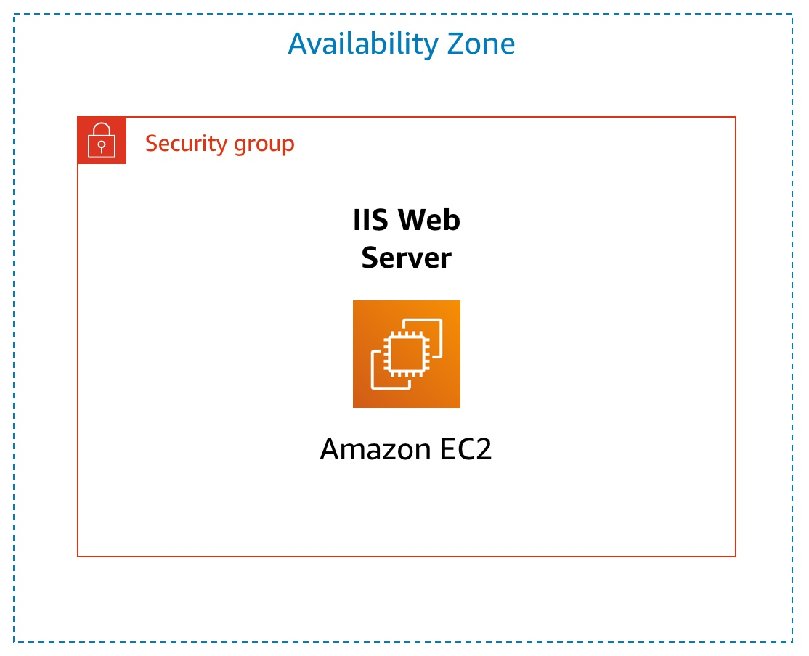

# Introduction to Amazon EC2

> Launch an Apache web server on EC2 from user data, make it reachable from the internet, then resize the instance and its EBS volume.

**AWS services:** EC2, EBS, VPC, Security Groups, CloudWatch (instance monitoring)
**Tools:** AWS Management Console, bash (user data)

## Objective

Walk through the full life cycle of an EC2 instance: launch it with a bootstrap script that installs a web server,
verify it is healthy, expose it to the internet, scale it vertically, and shut it down.
Two things in that sequence don't work on the first try, and both are about configuration around the instance rather than inside it.

## Architecture

A single EC2 instance in one Availability Zone, wrapped by a security group that controls all inbound traffic to it.
The security group is the only thing standing between the web server and the internet — which is where the first issue comes from.
(The course diagram labels the box "IIS Web Server"; my instance runs Apache `httpd`, installed by the user data script.)

## What I built

1. Launched a `t3.micro` instance from an Amazon Linux AMI with an 8 GiB EBS root volume: name, AMI, instance type, key pair, VPC and security group.
2. In the advanced settings, enabled termination protection and pasted a bash script into **user data**, which runs once on first boot as root.
3. The script installs Apache (`httpd`), enables it so it survives a reboot, starts it, and writes a one-line `index.html`.
4. Waited for both status checks to pass before touching the instance, and looked at the basic usage metrics.
5. Hit the security group problem below, fixed it, and confirmed the page loaded in the browser.
6. Stopped the instance, resized it to `t3.small` (same AMI) and grew the EBS volume from 8 GiB to 10 GiB, then started it again.
7. Terminated the instance — which failed the first time, for the reason in Issue 2.

## Issues found

### Issue 1 — Web server running, but unreachable from the browser

- **Symptom:** the instance launched and the user data ran, but opening the instance's public address in the browser never loaded the page.
- **Diagnosis:** started at the instance, not at the network. Both status checks were passing, and I pulled the console output with **Get instance screenshot** to see the machine itself rather than trust the dashboard — it had booted normally. With the instance ruled out, the problem had to be in front of it, and the next thing in front of it is the security group, so I opened its inbound rules.
- **Root cause:** the security group had no inbound rule for HTTP, so port 80 traffic from the internet was dropped before it ever reached Apache. Security groups deny all inbound traffic that isn't explicitly allowed.
- **Fix:** added an inbound rule — **Type: HTTP (TCP 80), Source: Anywhere-IPv4 (`0.0.0.0/0`)**. The page loaded right after, with no change to the instance itself.

> `0.0.0.0/0` is what the lab asks for, since the page is meant to be public. For anything real the source should be restricted — your own IP, or a load balancer's security group.

### Issue 2 — Terminate failed on an instance I had protected myself

- **Symptom:** at the end of the lab, terminating the instance returned an error instead of shutting it down.
- **Diagnosis:** I had enabled termination protection at launch (step 2) without thinking about how to undo it. The flag has to be cleared before the instance will accept a terminate call, so I looked up where that setting lives in the console.
- **Root cause:** termination protection was still enabled on the instance.
- **Fix:** disabled termination protection in the instance settings, then terminated the instance successfully.

## Key takeaways

- "The service is running" and "the service is reachable" are two different problems. The web server was healthy the whole time; the packets never arrived.
- Status checks and **Get instance screenshot** are elimination tools: they confirm the instance booted and is healthy, which moves the search to the networking around it. Confirming where the problem *isn't* is what makes the next step obvious.
- Security groups are allow-lists — anything not explicitly permitted inbound is dropped, and dropped silently, so the browser hangs instead of refusing. That hang is the signature of a firewall rather than a dead service.
- A security group change takes effect immediately: no restart, no redeploy. If a config change fixes it instantly, the instance was never the problem.
- User data runs once, at first boot, as root. `systemctl start` starts the service now; `systemctl enable` is what brings it back after a reboot — the script does both on purpose.
- Changing an instance type is not a live operation: the instance has to be stopped first. Vertical scaling on EC2 costs downtime.
- Termination protection does its job, including against you. It's a deliberate second step, not a confirmation dialog.

## Files

- `scripts/user-data.sh` — the bootstrap script passed as user data at launch: installs Apache, enables and starts it, and writes the test page.
