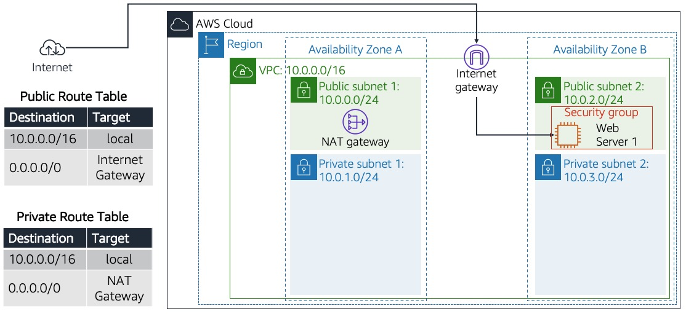
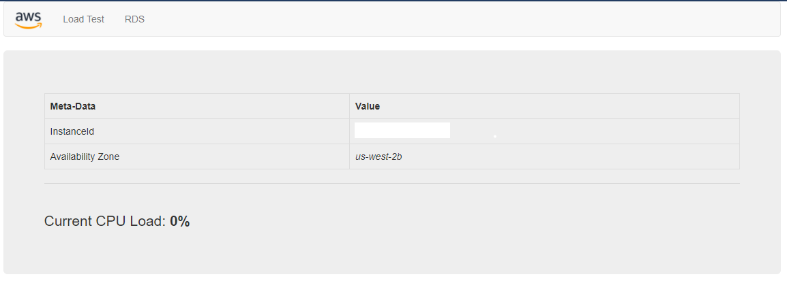

# Build your VPC and Launch a Web Server

> Build a custom multi-AZ VPC from scratch — subnets, internet gateway, NAT gateway and route tables — and launch a PHP web server into it.

**AWS services:** VPC, Subnets, Internet Gateway, NAT Gateway, Route Tables, Security Groups, EC2
**Tools:** AWS Management Console, bash (user data)

## Objective

Build the network before the server. Instead of launching into a default VPC, create the whole thing by hand:
address space, public and private subnets across two Availability Zones, the two gateways that give each kind of
subnet its internet access, and the route tables that actually make a subnet "public" or "private".
Then launch an EC2 web server into it and confirm it answers from the internet.

## Architecture

A `10.0.0.0/16` VPC spread over two Availability Zones, with a public and a private subnet in each:

| Subnet | CIDR | AZ | Route for `0.0.0.0/0` |
|---|---|---|---|
| Public subnet 1 | `10.0.0.0/24` | A | Internet gateway |
| Private subnet 1 | `10.0.1.0/24` | A | NAT gateway |
| Public subnet 2 | `10.0.2.0/24` | B | Internet gateway |
| Private subnet 2 | `10.0.3.0/24` | B | NAT gateway |

The NAT gateway sits in a public subnet but exists to serve the private ones: it gives instances with no public
address a way out to the internet without giving the internet a way in. The web server runs in public subnet 2.

## What I built

1. Created the VPC with a `10.0.0.0/16` address range.
2. Created the first public/private subnet pair in one AZ, and put a NAT gateway in the public subnet.
3. Created the second public/private subnet pair in a second AZ, so the network spans two AZs.
4. Created the route tables and associated the subnets: the public table routes `0.0.0.0/0` to the internet gateway, the private table routes it to the NAT gateway.
5. Created a security group allowing inbound HTTP from any IPv4 address.
6. Launched a `t3.micro` Amazon Linux instance into public subnet 2 with that security group, passing a bootstrap script as user data.
7. The script installs Apache, PHP and the MySQL client, downloads the lab application into `/var/www/html/` and starts the web server.
8. Opened the instance's public IPv4 DNS name and got the application, which reports its own instance ID, Availability Zone and CPU load.

## Issues found

### Issue 1 — A "multi-AZ" network that was really single-AZ

- **Symptom:** nothing was broken. The VPC was built, the routes worked and the web server answered. But on the final pass over the build, the subnets that were supposed to be split across two Availability Zones were all sitting in the same one.
- **Diagnosis:** the deployed application reports the Availability Zone of the instance running it, right next to the instance ID:

  

  *(Reference output from the lab, not a screenshot of my own instance — I documented this lab some time after running it.)*

  Seeing the AZ surfaced as a value in the page is what made me go and check the AZ of every subnet I had created, rather than assume. They were all the same one. The step-by-step had been followed correctly and everything was green, so nothing in the console flagged it — the subnets existed, the routes resolved, the server was up. Comparing the result against the architecture diagram, instead of against the step list, is what confirmed it.
- **Root cause:** a subnet's Availability Zone is chosen when the subnet is created, and the second pair was created in the same AZ as the first. Most likely the AZ selector was left on its **"No preference"** default, which lets AWS place the subnet — so the choice that the whole design depends on was never actually made. The redundancy the two-subnet-pair layout exists for simply wasn't there.
- **Fix:** an existing subnet can't be moved to another AZ, so there was nothing to edit — the subnets had to be destroyed and rebuilt. I deleted both subnets of the first pair, public and private, and recreated them in a second AZ. I chose that pair because the EC2 instance was running in public subnet 2: moving the other pair would have meant terminating the web server.

  That choice protected the workload, but the fix was still not cheap. A subnet can't be deleted while anything lives inside it, and the NAT gateway was inside public subnet 1 — so it had to be torn down first and stood up again in the new subnet, and the new subnets had to be re-associated with the route tables. Correcting one dropdown meant rebuilding most of that half of the network. Then I re-checked the whole build against the diagram.

## Key takeaways

- An Availability Zone is a property you set when you create a subnet and can never change afterwards. Getting it wrong means delete and recreate — there is no "move".
- Two subnets are not two Availability Zones. A multi-AZ design can be fully built, fully working and still give you none of the redundancy you think you bought.
- Nothing fails when you get this wrong, which is what makes it dangerous. You find out during the outage the second AZ was supposed to cover.
- What makes a subnet public or private is not a checkbox on the subnet — it's the route table associated with it. `0.0.0.0/0` to an internet gateway means public; to a NAT gateway means outbound-only.
- A NAT gateway lives in a public subnet but serves the private ones: outbound internet for instances that have no public address and accept no inbound connections.
- A subnet is the anchor everything else attaches to, so getting its AZ wrong is never a one-field fix. The NAT gateway, the route table associations and anything running inside come down with it. The cost of the mistake is not the mistake — it's the blast radius of the correction.
- When repairing infrastructure, start from the resource that isn't carrying the workload. Rebuilding the pair without the instance still cost real work, but it kept the web server up instead of trading an invisible problem for a visible outage.
- Checking the finished build against the architecture diagram catches what following the steps correctly will hide from you.

## Files

- `scripts/user-data.sh` — bootstrap script passed as user data: installs Apache, PHP and the MySQL client, deploys the lab application to `/var/www/html/` and starts the web server on boot.
