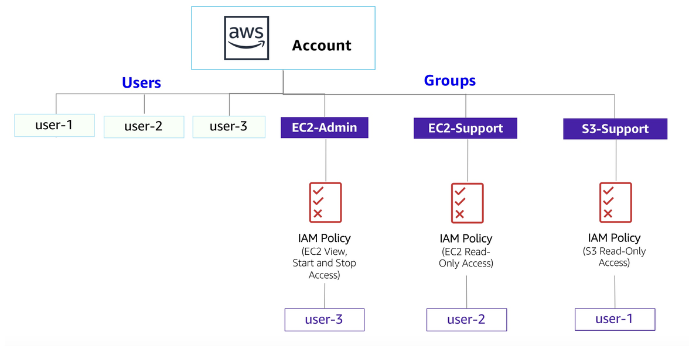

# Introduction to AWS Identity and Access Management (IAM)

> Give three new hires only the access their job needs, using IAM groups and policies instead of per-user permissions.

**AWS services:** IAM, EC2, S3
**Tools:** AWS Management Console

## Objective

Control who can do what inside an AWS account. In the scenario, three new staff members with different job functions
need access to EC2 or S3, and each one should get no more than the role requires. The account password policy is tightened along the way.

## Architecture

Permissions are attached to groups, not to people: a user gets access by being a member of a group.

| User | Group | Policy | Policy type | Intended access |
|---|---|---|---|---|
| `user-1` | S3-Support | `AmazonS3ReadOnlyAccess` | AWS managed | List and read S3 |
| `user-2` | EC2-Support | `AmazonEC2ReadOnlyAccess` | AWS managed | View EC2, change nothing |
| `user-3` | EC2-Admin | `EC2-Admin-Policy` | Customer inline | View, start and stop EC2 instances |

Users, groups and policies came pre-created in the lab environment.

## What I built

1. Replaced the default account password policy with a stricter one: minimum length raised from 8 to 10, every requirement enabled except forcing an administrator reset on expiry, 90-day expiration and no reuse of the last 5 passwords.
2. Read the policy document attached to each group (`Effect`, `Action`, `Resource`) to understand what it allows.
3. Added each user to the group that matches their role.
4. Signed in as the different users through the account's IAM sign-in URL to check the permissions in practice.

## What I tested

- **Actions outside a user's permissions:** when I tried to do something the signed-in user wasn't allowed to do, AWS refused it with a not-authorized error. The group policy was being enforced, not just listed.
- **Changing Region:** even as `user-3`, who can manage EC2, switching the console to another Region meant I could no longer see the instance I was supposed to manage. EC2 instances belong to a single Region and the console shows one Region at a time, so having permission is not enough if you are looking in the wrong place.

## Key takeaways

- IAM is how access is managed in AWS: define what each user can and cannot do, and grant only what the job needs (least privilege), in line with AWS best practices and compliance requirements.
- Grant permissions to groups rather than individuals: onboarding becomes a membership change, and everyone in the same role gets the same access.
- IAM denies by default. A policy statement (`Effect`, `Action`, `Resource`) has to allow something explicitly, and the difference between "support" and "admin" is which actions are listed.
- AWS managed policies are reusable and updated centrally; an inline policy lives inside a single user or group and suits one-off cases.
- IAM is global, but resources such as EC2 instances are Regional. Check the selected Region before concluding that something is missing.
